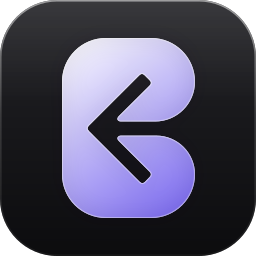

<p align="center">
  
</p>

<p align="center">
  <strong>Свой Discord на своём сервере. Текст, голос, видео, демонстрация экрана.</strong><br>
  Форк <a href="https://github.com/TheZwiss/backspace">TheZwiss/backspace</a> со своими правками интерфейса и своими сборками приложения.
</p>

<p align="center">
  <a href="https://github.com/funpin/backspace/releases/latest"></a>
  <a href="https://github.com/funpin/backspace/actions/workflows/ci.yml"></a>
  
  <a href="LICENSE"></a>
</p>

<p align="center">
  <a href="https://github.com/funpin/backspace/releases/latest"><b>Скачать</b></a> ·
  <a href="#быстрый-старт"><b>Быстрый старт</b></a> ·
  <a href="#чем-форк-отличается-от-оригинала">Отличия от оригинала</a> ·
  <a href="docs/systems">Как устроено</a>
</p>

<p align="center"></p>

## Что умеет

| | |
|---|---|
| **Голос и видео** | Каналы и звонки в личных сообщениях. Громкость от 0 до 200 % отдельно для каждого человека и каждой трансляции, шумоподавление RNNoise, сведения о соединении в реальном времени. |
| **Демонстрация экрана** | Разрешение, частота кадров, кодек (VP9 или аппаратный H.264) и битрейт — на выбор, до 4K при 120 кадрах в секунду в пределах, заданных администратором. Звук системы передаётся вместе с картинкой. |
| **Чат** | Каналы и категории, ответы, реакции, упоминания, стикеры, вложения, предпросмотр ссылок, поиск по сообщениям с фильтрами. |
| **Личные сообщения** | Один на один и группы до 10 человек, звонки, друзья и заявки в друзья. |
| **Роли и модерация** | Права по ролям с переопределением для категорий и каналов, баны с причиной, отключение микрофона и звука участнику, заявки на вступление. |
| **Федерация** | Независимые серверы связываются между собой: друзья, личные сообщения и звонки работают между серверами, каждый остаётся у своего владельца. |
| **Где работает** | Браузер, приложение для Windows и macOS, телефон — как устанавливаемое веб-приложение. |

<table>
  <tr>
    <td width="50%"><br><sub><b>Чат</b> — каналы, ответы, реакции</sub></td>
    <td width="50%"><br><sub><b>Демонстрация экрана</b> — качество выбирает тот, кто показывает</sub></td>
  </tr>
  <tr>
    <td width="50%"><br><sub><b>Личные сообщения</b> — в том числе между серверами</sub></td>
    <td width="50%"><br><sub><b>Федерация</b> — связанные серверы в панели администратора</sub></td>
  </tr>
</table>

## Чем форк отличается от оригинала

| | |
|---|---|
| **Сборки приложения** | Две, без лишнего: **Windows x64** (установщик) и **macOS Apple Silicon** (DMG). Linux, Windows на ARM и Intel-Mac здесь не собираются — их выпускает [оригинальный проект](https://github.com/TheZwiss/backspace/releases). |
| **Ссылки и обновления** | Приложение, панель «Скачать» и проверка обновлений ведут на этот репозиторий, а не на оригинал: версии расходятся, и исходный код должен быть тот, что реально запущен (AGPL, раздел 13). |
| **Сервер** | Свой образ Docker (`ghcr.io/funpin/backspace`) и три необязательные настройки: создание пространств только администратором, срок хранения вложений, отключение миниатюр. |
| **Голосовой канал** | Одна плитка на человека вместо двух, участники без видео — лентой под сеткой, плитки можно скрывать и переставлять. |

Основная ветка регулярно догоняет оригинал: `main` = `upstream/main` + правки форка.

## Быстрый старт

**Приложение.** Скачайте сборку со страницы [последнего релиза](https://github.com/funpin/backspace/releases/latest): **Windows** — установщик, **macOS (Apple Silicon)** — DMG. При первом запуске укажите адрес своего сервера. Новую версию ставьте поверх старой: вход и настройки сохраняются.

**Сервер.** Нужен Linux-хост с Docker и домен:

```bash
git clone https://github.com/funpin/backspace.git && cd backspace
./install.sh
```

Установщик сам настроит `.env`, секреты, HTTPS и, если нужно, голос. Первый зарегистрированный пользователь становится администратором. Обновление — `./update.sh`, резервные копии и восстановление — `./backup.sh` и `./restore.sh`.

Режимы за своим обратным прокси или туннелем, порты и голос подробно разобраны в [документации по развёртыванию](docs/systems/deployment.md) и в [README оригинала](https://github.com/TheZwiss/backspace#installation).

<details>
<summary><b>Как устроено</b></summary>

- **Сервер** — Node.js, Fastify, SQLite через Drizzle; один контейнер, данные в `data/`.
- **Клиент** — React, Vite, Tailwind, Zustand; интерфейс «Aether Drift»: тёплые матовые поверхности и матовое стекло для плавающих элементов.
- **Голос и видео** — LiveKit; сервер только выдаёт токены, медиа идёт через SFU.
- **Приложение** — Electron: глобальные сочетания клавиш, запуск при входе в систему, значок в трее, определение запущенной игры.
- **Федерация** — запросы между серверами подписаны HMAC, события доставляются через очередь с повторами.

Подробно по каждой подсистеме — в [docs/systems](docs/systems): [голос](docs/systems/voice.md), [федерация](docs/systems/federation.md), [права](docs/systems/permissions.md), [база данных](docs/systems/database.md), [приложение](docs/systems/desktop.md), [дизайн-система](docs/systems/design-system.md).
</details>

<details>
<summary><b>Разработка</b></summary>

Node.js 22.12 или новее (в `.nvmrc` — 24) и pnpm 10:

```bash
pnpm install
cp .env.example .env    # задайте JWT_SECRET: openssl rand -hex 32
pnpm dev                # сервер на :3005, клиент на :5173
pnpm typecheck && pnpm test
```

Экраны можно смотреть без сервера и без звонка: страницы `packages/web/dev-*.html` открываются с того же dev-сервера, например `http://localhost:5173/dev-voice-grid.html`.

Как ведётся форк:

- `origin` — этот репозиторий, `upstream` — оригинал. Работа идёт в ветках `feat/…`, `fix/…`, `chore/…` от `main` и попадает в `main` через pull request.
- Чтобы догнать оригинал: `git fetch upstream && git merge upstream/main` в отдельной ветке, затем pull request.
- Версия форка — версия оригинала, на которой он стоит, плюс своя ревизия: `1.11.0-f.1.0` значит «ревизия 1.0 поверх оригинального 1.11.0». Поднимается командой `node scripts/bump-version.mjs 1.11.0-f.1.1`.
- Релиз — тег `v<версия>` на `main`: [workflow](.github/workflows/release.yml) собирает обе сборки и создаёт черновик релиза с таблицей загрузок.

Правила для агента — в [CLAUDE.md](CLAUDE.md), участие — в [CONTRIBUTING.md](CONTRIBUTING.md).
</details>

## Лицензия

[GNU AGPL-3.0](LICENSE): пользуйтесь, меняйте и распространяйте свободно, если ваши изменения тоже открыты. Это форк [Backspace](https://github.com/TheZwiss/backspace) © TheZwiss и участники проекта; оригинал также предлагает [коммерческую лицензию](LICENSE-COMMERCIAL.md) — она относится к оригинальному коду и выдаётся его автором.

Правки форка © 2026 funpin
